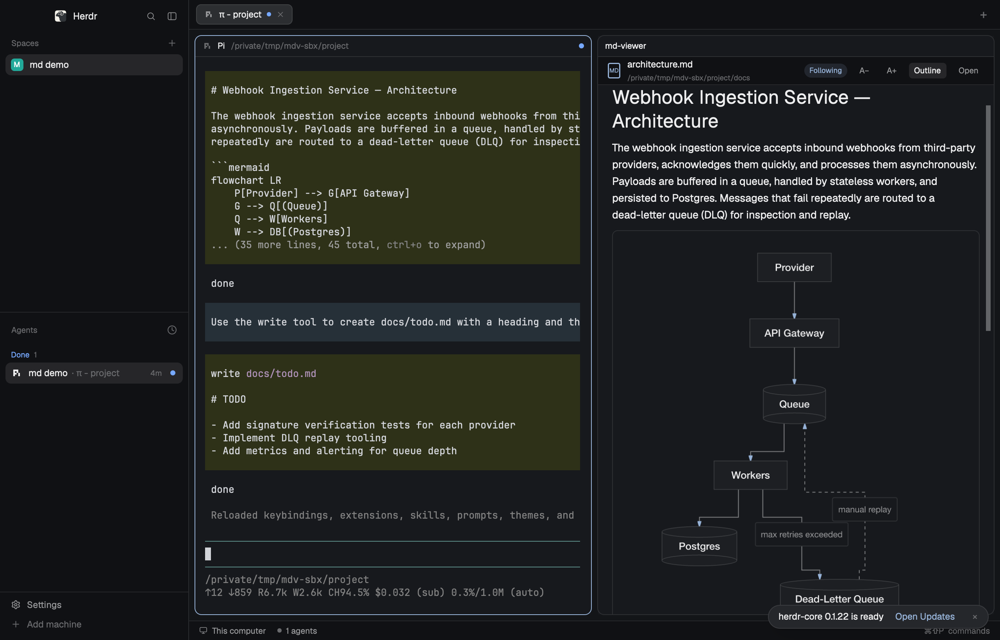
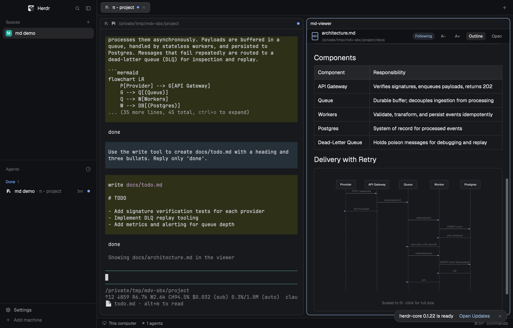
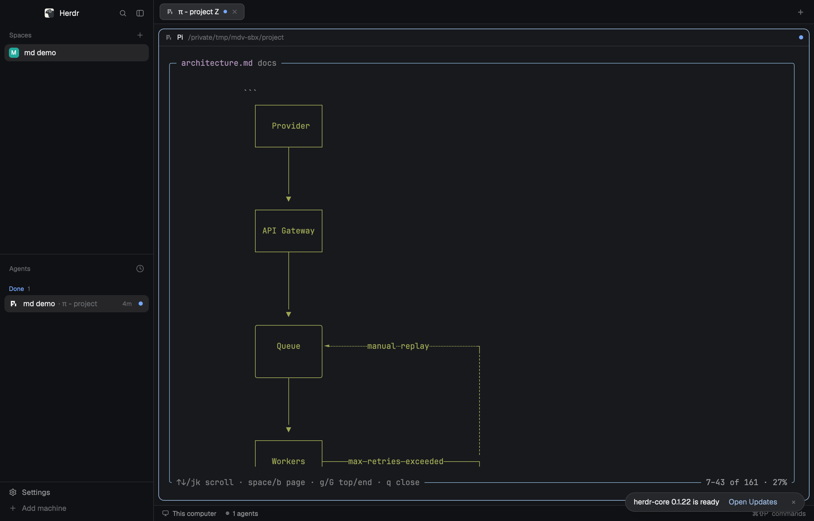

# md-preview

`/md` for [Pi](https://github.com/earendil-works/pi): read the Markdown files your agent writes in a proper viewer, with Mermaid diagrams rendered, instead of squinting at raw text in the terminal.



## What it does

### The pane opens by itself

In the Herdr app there is nothing to type. When the agent writes a `.md`, a native reading pane opens beside Pi (the keyboard stays in Pi). It follows each new `.md` the agent writes and reloads live as the file changes.

Above: the agent wrote `docs/architecture.md`. The pane shows it with proportional type, and the ```` ```mermaid ```` flowchart is drawn as a real diagram. Cylinders, dashed edges and edge labels included. Wide left-to-right charts get laid out top-to-bottom when that fits the pane better.

### Tables, sequence diagrams, outline



- Tables, code blocks, quotes, task lists, front matter as a card
- Sequence diagrams and other Mermaid types; click a diagram for full size
- Clickable **Outline** to jump between sections, recent files, **A− / A+** for text size
- **Following** toggle: keep the pane on the newest `.md`, or pin the current one
- Pi's footer names the latest file the agent wrote (`📄 todo.md · alt+m to read`)

### A reader inside Pi, anywhere



Not in the Herdr app (Herdr TUI, plain terminal, SSH)? Press **alt+m** and the latest `.md` opens in a full-screen reader inside Pi. Mermaid diagrams are drawn with box-drawing characters, so you still see the shape of the system, not the `flowchart LR` source.

Keys: `↑↓` or `j/k` scroll · `space/b` page · `g/G` top/end · `q` or `Esc` close.

Everything renders locally with [beautiful-mermaid](https://github.com/lukilabs/beautiful-mermaid) and resvg. No browser, no network.

## Commands

```
/md                 pick a file (this session's .md files first, then the project's newest)
/md <file>          open that file
/md --here [file]   read inside Pi instead of a Herdr pane
/md auto on|off     open the pane by itself when the agent writes a .md (default on)
/md follow on|off   the open pane jumps to each new .md (default on)
/md --help
```

Close the pane and it stays closed until you ask again (`/md` or alt+m).

## Install

```bash
git clone https://github.com/nexty5870/md-preview.git ~/.pi/agent/extensions/md-viewer
cd ~/.pi/agent/extensions/md-viewer && npm install
```

Then restart Pi (or `/reload`). The first `/md` in the Herdr app copies `herdr-mod/` to `~/.config/herdr-app/mods/md-viewer` (it never overwrites a mod it didn't install).

Try it on the bundled example: `/md examples/auth-migration-plan.md`.

Optional keys for the pane (`~/.config/herdr-app/keys.json`):

```json
"mod:md-viewer": { "j": "md-viewer.next", "k": "md-viewer.prev", "g": "md-viewer.top" }
```

## Files

- `index.ts`: the `/md` command, tracking of `.md` writes, follow mode
- `files.ts`: finding the session's and project's Markdown files
- `herdr.ts`: installs the mod, opens the pane beside this Pi, the control file it re-reads
- `overlay.ts`: the in-Pi full-screen reader
- `mermaid.ts`, `render-mermaid.ts`: diagrams (text drawings for Pi, PNGs for the pane, cached in the mod folder)
- `herdr-mod/`: the Herdr app mod (gpui-kit)
- `preview/`: the screenshots above
