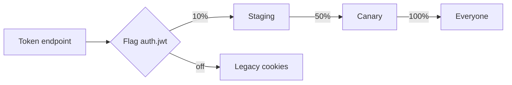
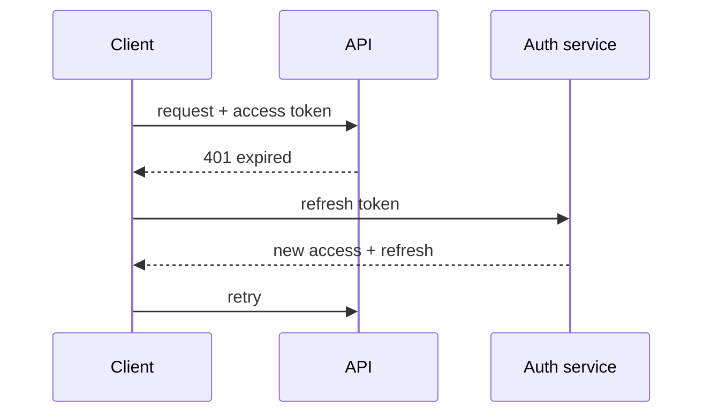

# Auth migration plan

We move sign-in from the legacy session cookies to **short-lived JWTs** with refresh tokens, without logging anyone out.

> The hard part isn't the tokens. It's the two weeks where both systems are live.

## What changes

1. New `/auth/token` endpoint issues an access token (15 min) and a refresh token (30 days).
2. The API accepts **both** cookies and bearer tokens during the overlap.
3. Clients switch over behind the `auth.jwt` flag, 10% → 50% → 100%.

## Rollout



## Risks

| Risk | Likelihood | Mitigation |
|------|-----------|------------|
| Refresh token theft | Low | Rotate on every use, bind to device |
| Clock skew on edge | Medium | 30 s leeway on `exp` |
| Mobile apps on old builds | High | Keep cookies for 60 days |

## Token check

```ts
export async function verify(token: string): Promise<Claims> {
  const { payload } = await jwtVerify(token, key, { clockTolerance: 30 });
  if (payload.typ !== "access") throw new Error("wrong token type");
  return payload as Claims;
}
```

## Refresh flow



## Open questions

- Do we keep `remember me`, or is 30 days the new default?
- Who owns key rotation: platform or security?
- [x] Agree on token lifetimes
- [ ] Load-test the refresh path

---

*Next step:* ship the endpoint behind the flag and run it on staging for a week.
